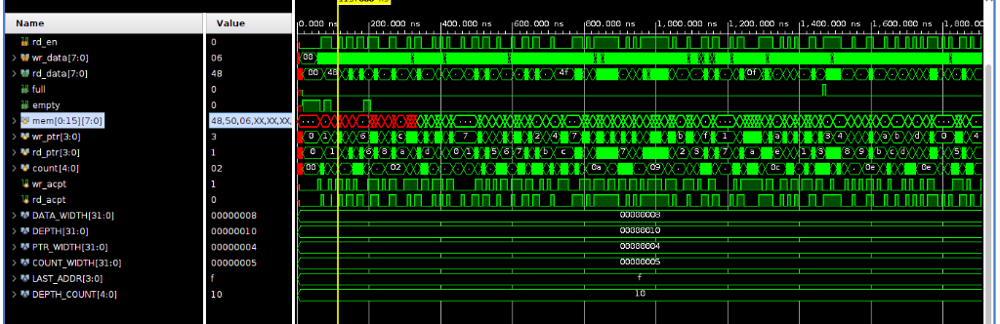

# Synchronous FIFO Verification

Class-based SystemVerilog testbench for a single-clock synchronous FIFO (`rtl/fifo.sv`), simulated with Vivado XSIM 2025.2. No UVM.

The FIFO has `DATA_WIDTH` (default 8) and `DEPTH` (default 16) parameters. A write is accepted when `wr_en && !full`, a read when `rd_en && !empty`. `rd_data` is registered.

The testbench comprises a generator, driver, monitor, queue-based reference model, scoreboard, and functional coverage collector. White-box assertions (`sva/fifo_sva.sv`) are attached via `bind` to verify pointers, flags, and count invariants without touching RTL. More details are in `docs/verification_plan.md`.

## Run

```bash
make compile             # Compile SystemVerilog sources into out/
make elaborate           # Elaborate snapshot with code coverage (-cc_type sbct)
make sim                 # Run simulation (Sanity, Corner/Stress, Constrained-Random)
make sim SEED=12345      # Run simulation with specific seed
make wave                # Open Vivado waveform GUI
make regression          # 20 random seeds automated suite
make cov_report          # Show HTML coverage report locations
make clean               # Clean all artifacts in out/ and root
```

## Structure

```
.
├── Makefile
├── README.md
├── docs
│   ├── img
│   │   └── wave_overview.png
│   └── verification_plan.md
├── filelists
│   └── tb.f
├── rtl
│   └── fifo.sv
├── scripts
│   └── regression.py
├── sva
│   ├── fifo_bind.sv
│   └── fifo_sva.sv
└── tb
    ├── fifo_coverage.sv
    ├── fifo_driver.sv
    ├── fifo_generator.sv
    ├── fifo_if.sv
    ├── fifo_monitor.sv
    ├── fifo_pkg.sv
    ├── fifo_reference_model.sv
    ├── fifo_scoreboard.sv
    ├── fifo_tb_top.sv
    ├── fifo_test.sv
    └── fifo_transaction.sv
```

## Waveform



## Results

- **Test Suite:** 3 test scenarios (Sanity, Corner & Stress, Constrained-Random).
- **Regression:** 20 random seeds: 100% PASSED (0 scoreboard errors, 0 assertion failures, 0 timeout).
- **Coverage:** 100.00% Functional Coverage across all seeds, 100% Statement & Branch Coverage on `fifo.sv`.
- **Reports:** Summaries saved in `out/regression_summary.rpt`, HTML dashboards in `out/fcov_rpt/`, per-run logs in `out/runs/`.